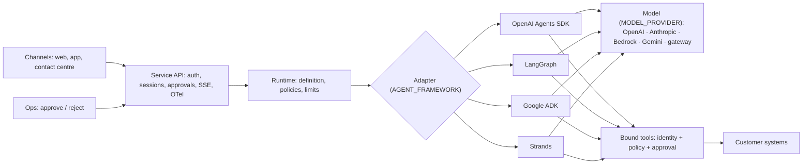

# agent-starter-kit

**Define an agent once, run it on the framework your customer chose.** A framework-neutral starter kit for
production agents: one agent definition (instructions, typed tools, policies, approvals, model), four framework
adapters (**OpenAI Agents SDK, LangGraph, Google ADK, Strands Agents**), and one service API in front of them, with
sessions, end-user identity, human approval for risky actions, streaming and OpenTelemetry, deployable to AWS,
Google Cloud or anywhere a container runs.

Built for partners: the first weeks of most agent engagements go to the same plumbing. This kit is that plumbing,
written once, without forcing a framework, a model or a cloud on the customer.

[](https://github.com/koushikmohanbhat/agent-starter-kit/actions/workflows/ci.yml)
Apache-2.0 · Python 3.10+

## Try it in two minutes (no keys)

```bash
pip install "agent-starter-kit[all] @ git+https://github.com/koushikmohanbhat/agent-starter-kit"
kit init my-agent && cd my-agent
kit test --parity          # 12 conversations × 4 frameworks, offline
kit run "Please refund my headphones, order ORD-10004"
kit dev                    # http://127.0.0.1:8080: chat, watch tool calls, approve the refund
```

Offline, a scripted model sits behind an OpenAI-compatible endpoint, so every framework runs the same conversation
through its real model path. Switch to a real model with two settings (`MODEL_PROVIDER`, `MODEL_NAME`).

## What's in it

| | |
|---|---|
| **One definition** | `agent.yaml`: framework, model, versioned instructions (`prompts/` + `prompts.lock`), tools, policies, limits, sessions. No environment-specific values: everything is `${VAR}` from `.env` or the deploy environment. [docs/define-an-agent.md](docs/define-an-agent.md) |
| **Typed tools** | Plain Python functions; JSON schema from type hints. End-user identity reaches tools in `ctx`, never as a model argument, so tools enforce record-level access ("only your own orders") whatever the prompt says |
| **Policies and approvals** | Sandboxed rules before every tool call: `allow`, `deny`, or `require_approval` (e.g. refunds above ₹5,000 need a support lead). Held actions run with the original customer's identity once approved; the customer is told the outcome. [docs/approvals.md](docs/approvals.md) |
| **Four adapters** | OpenAI Agents SDK (default), LangGraph, Google ADK, Strands Agents. Each uses the framework's own loop, tool calling and model clients. [docs/adapters.md](docs/adapters.md) |
| **Parity suite** | The same conversations on every adapter must give the same tool calls, final state and approvals. CI runs it on every change |
| **Any model** | OpenAI (Responses API), Anthropic, Amazon Bedrock, Gemini on the Gemini Enterprise Agent Platform, any OpenAI-compatible gateway |
| **Service API** | `POST /v1/chat` (JSON or SSE), sessions, approvals, user erasure, `/v1/agent`, health. Auth: OIDC JWT or API key + end-user header. [docs/service-api.md](docs/service-api.md) |
| **Operations** | Sessions in memory, SQLite or Postgres; OTel GenAI spans (`invoke_agent` → `execute_tool`) on every adapter; turn and tool-call limits; timeouts |
| **Deploy** | Dockerfile, Docker Compose, Terraform for **ECS Fargate** and **Cloud Run**, wrappers for **AgentCore Runtime** and **Agent Runtime**. [docs/deploy.md](docs/deploy.md) |
| **Add-ons (optional)** | `kit add evals`: an eval suite for this agent on the [GenAI Eval Framework](https://github.com/koushikmohanbhat/genai-eval-framework). `kit add dpdp`: hooks for the [DPDP Data Rights Framework](https://github.com/koushikmohanbhat/dpdp-data-rights-framework). [docs/add-ons.md](docs/add-ons.md) |

## How it works



## The support-agent kit

`kits/support-agent`: order status, refunds (held for approval above the limit), address changes before shipping,
and escalation to a person, against an in-memory order store or the bundled mock order API. Replace the order
client with the customer's system; the tools, policies and service don't change. [kits/support-agent/README.md](kits/support-agent/README.md)

## Project status

v0.1.0. Maturity, in the same terms as the GenAI Eval Framework:

| | Status |
|---|---|
| Core, service API, policies, approvals, stores (memory, SQLite) | tested (unit + API tests) |
| OpenAI Agents SDK, LangGraph, Google ADK, Strands adapters | **parity tested** (scripted model through each framework's OpenAI-compatible path, in CI) |
| Real models (OpenAI, Anthropic, Bedrock, Gemini) through each adapter | implemented, **not yet live tested** |
| Postgres store, OIDC against a real IdP | implemented (OIDC tested with locally signed JWTs) |
| ECS Fargate and Cloud Run Terraform, Docker image | validated in CI (`terraform validate`, `docker build`); not yet applied live |
| AgentCore Runtime and Agent Runtime wrappers, DPDP add-on | implemented, not yet deployed / tested live |

Read [docs/limitations.md](docs/limitations.md) before production use.

## Docs

[Getting started](docs/getting-started.md) · [Define an agent](docs/define-an-agent.md) · [Adapters](docs/adapters.md) ·
[Approvals](docs/approvals.md) · [Service API](docs/service-api.md) · [Deploy](docs/deploy.md) ·
[Security](docs/security.md) · [Add-ons](docs/add-ons.md) · [Limitations](docs/limitations.md)
